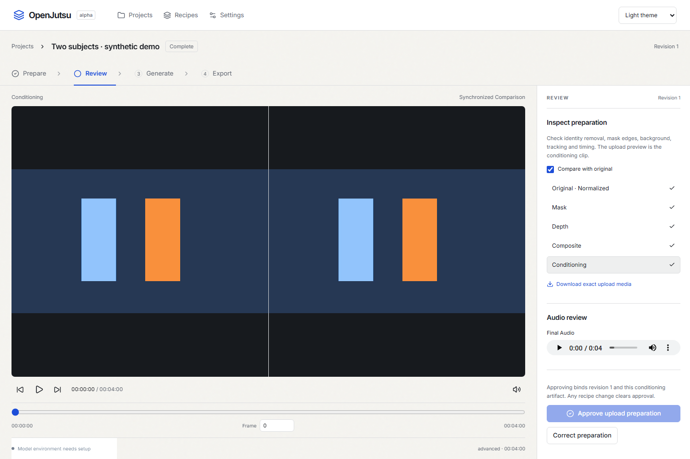
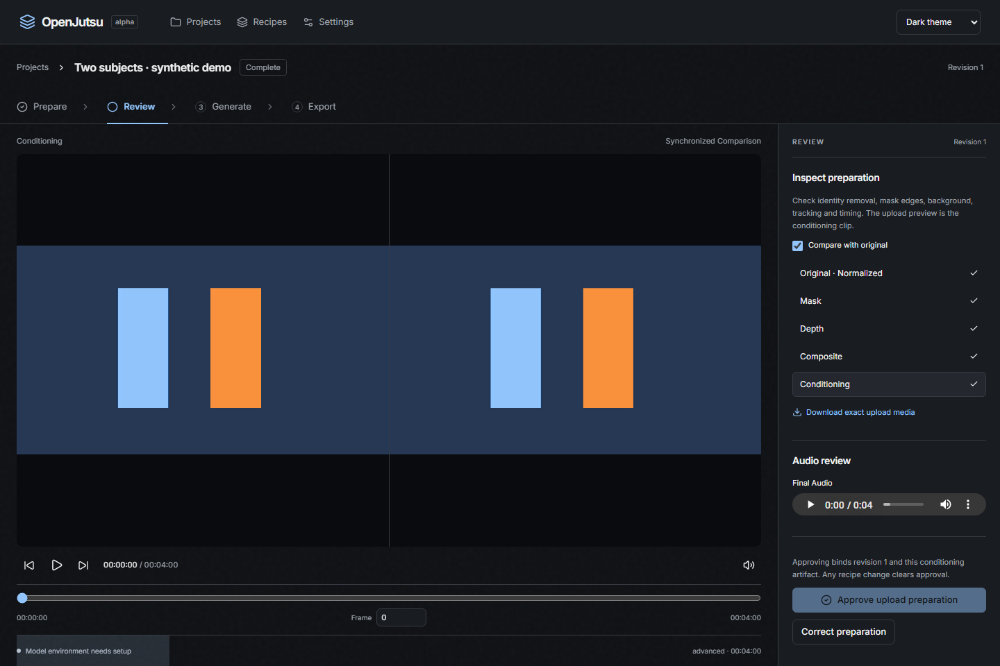

# OpenJutsu

A personal, local video preparation and generation studio. Prepare on your GPU, review the exact conditioning media, compare cloud previews, and choose native continuation, local upscaling or original resolution.

**Alpha release:** the studio and durable backend are implemented and locally tested. Cloud adapters have synthetic contract coverage; live billing, media eligibility and generation quality require your own configured, budgeted pilot. No provider is shipped qualified. This project makes no claim about Higgsfield's proprietary internals.



<details><summary>Dark studio</summary>



</details>

## Requirements

- Ubuntu WSL2 on Windows, or Linux; Python 3.12, Git, FFmpeg/FFprobe, [uv 0.13.0](https://docs.astral.sh/uv/getting-started/installation/), `python3-venv`.
- Node.js 22+ and pnpm 11.22.0 for the frontend build.
- NVIDIA CUDA GPU for model preparation. Tested on RTX 4080 SUPER 16 GB; 64 GB host RAM, 48 GB available to WSL. Other GPUs and long clips need validation.
- Own provider account and private S3-compatible storage for cloud generation. Local preprocessing needs neither.

The job database, cache, models and artifacts live on Linux, under `~/.local/share/openjutsu`. Import recordings from Windows through `/mnt/DRIVE/path`. Originals are copied immutably. Keep source recordings and full transcripts out of Git.

## Install and launch

In Ubuntu:

```bash
sudo apt-get update
sudo apt-get install -y ffmpeg git python3-venv
curl -LsSf https://astral.sh/uv/0.13.0/install.sh | sh
export PATH="$HOME/.local/bin:$PATH"
git clone https://github.com/MudabbirulSaad/openjutsu.git
cd openjutsu
bash scripts/setup.sh
runtime="$HOME/.local/share/openjutsu"
"$runtime/venv/bin/python" scripts/install_models.py depth sam2-large mesh audio whisper
```

Build the studio in the checkout, either on Windows or in Linux:

```bash
corepack enable
corepack prepare pnpm@11.22.0 --activate
cd web
pnpm install --frozen-lockfile
pnpm build
cd ..
```

Then start the backend in Ubuntu:

```bash
bash scripts/serve.sh
```

Open **http://127.0.0.1:9780**. The backend serves the production frontend. For UI development, run `pnpm --dir web dev`; its `/api` proxy uses port 9780. Port conflicts and WSL forwarding are covered in [troubleshooting](docs/troubleshooting.md).

Model installation is explicit and separate from application installation. See [models and licenses](docs/setup/models.md) for optional Qwen, SeedVR2, Real-ESRGAN, SAM 2.1 Small and the experimental gated SAM 3 adapter. Setup pins CPU and CUDA dependencies in separate environments; it does not silently fetch checkpoints during a job.

## Four-stage workflow

1. **Prepare:** import a video, trim a 4–30 second interval, choose Advanced/Fast/Combined, bind one or two references, and anchor subjects on the first frame. Use correction frames, point/box alternatives, original or timed custom speech, and optional local prompt assistance.
2. **Review:** inspect synchronized original, mask, numerical-depth preview, composite and mesh artifacts. Paused review uses indexed frames. Listen to conditioning and final audio, then approve that exact revision.
3. **Generate:** set a spending limit, configure eligible routes, and explicitly run a qualification pilot. Compare attempts and accept one preview. Every paid request has durable intent, reservation and provider task ID. Uncertain submissions require reconciliation.
4. **Export:** choose original resolution, SeedVR2 1080p, explicit Real-ESRGAN fallback, or native 1080p from the original draft/account. The selected unpitched soundtrack is restored. Keep the native master, browser delivery and recipe provenance separately.

Fast and Combined initially support one talking subject. Advanced supports up to two selected tracks. Mesh modes stop on tracking gaps; choosing Advanced or trimming the input is a useful alternative. Full-body references and whole-character prompts help address the body-replacement failure shown in the source video, but quality still needs human review.

## Checks

In Ubuntu, using the CPU application environment:

```bash
runtime="$HOME/.local/share/openjutsu"
"$runtime/api-venv/bin/ruff" check backend tests scripts
"$runtime/api-venv/bin/ruff" format --check backend tests scripts
"$runtime/api-venv/bin/python" -m pytest -q
python3 scripts/check_public_tree.py
```

Frontend and browser tests:

```bash
pnpm --dir web test
pnpm --dir web build
pnpm --dir web exec playwright install chromium
# In a separate Ubuntu terminal:
"$runtime/api-venv/bin/python" scripts/browser_fixture.py
# Then:
pnpm --dir web test:e2e
```

The browser fixture uses the real API/SQLite engine and synthetic media/provider completions. It never contacts a generation provider. CI runs CPU tests, formatting, repository hygiene, TypeScript/build and Chromium/accessibility checks. Optional GPU smoke commands and measured limitations are in [validation](docs/validation.md).

## Documentation and privacy

- [Video findings and sources](docs/research/video-findings.md) distinguish demonstrations from hypotheses.
- [System design](docs/architecture/system-design.md), [frontend specification](docs/architecture/frontend-design.md), [API/CLI](docs/api.md).
- [Provider setup and spending](docs/setup/providers.md), [model installation](docs/setup/models.md), [troubleshooting](docs/troubleshooting.md).
- [Local transcript instructions](docs/transcripts/README.md), [contributing](CONTRIBUTING.md), [security reporting](SECURITY.md).

Original media, transcripts, masks, depth, landmarks and processing remain local. Only reviewed conditioning and necessary references go to a chosen provider through expiring private URLs. Keys are excluded from responses, logs and recipe bundles. Provider retention and consent policies still apply. Browser closure does not stop local jobs; restarting the backend resumes completed-stage caches and remote status checks.

Application source is **Apache 2.0**. Dependencies, weights and imported media retain their own licenses; see [LICENSE](LICENSE) and [NOTICE](NOTICE). Independent code and branding, inspired by the creator's [published workflow](https://github.com/sirioberati/Genjustsu-Open-Source-Workflow).
