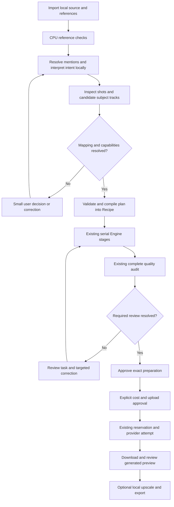

# Step 4.5 — Simplified workflow and progress architecture

**Status: approved architecture direction; no production implementation.** Reviewed on 2026-10-12 against
`f55050cb3d5ad76ca0b0f86714b0d17b34c51111` on `codex/step-4.5-workflow-design`.
The owner approved the architecture direction after review. Implementation follows separately
authorised stages. Step 5 is authorised after the design PR is merged; it has not begun.

The recommendation is to evolve the existing React Studio into two views over the same
revisioned job: Simple for the normal transformation, Advanced for precise corrections.
Use the existing Engine, artifact store, quality gate and event stream. Add a validated
preparation plan and durable operation progress; keep interpretation separate from execution.
No new workflow may weaken the Step 4 gate or silently choose a character mapping.

## Synchronisation and evidence

The checkout was clean before switching. `git fetch origin --prune`, `git switch main` and
`git pull --ff-only origin main` completed successfully. Local `main` and `origin/main` both
resolved to the merge SHA above. All original stage commits are ancestors:

| Stage                                            | Original commit                            |
| ------------------------------------------------ | ------------------------------------------ |
| 1: preserved failure baseline                    | `92300464b881c025063aa0b980e557bd22b4d904` |
| 2: contextual whole-person corrections           | `97edb688588d089680e3d453a347b457f1ac5c25` |
| 3: visibility, intervals and collision integrity | `4792582080448e34dbe361634e3934361a839ff6` |
| 4: preparation quality and approval gate         | `11e79b22738da274e32515fb9ebe68175aebb3ec` |

[PR #1](https://github.com/MudabbirulSaad/openjutsu/pull/1) was already merged by the owner.
The [Checks run for merged main](https://github.com/MudabbirulSaad/openjutsu/actions/runs/38170329901)
completed successfully: backend **101 passed, 88 private-fixture skips, 5 expected failures**;
Ruff lint and format passed; frontend **4 tests passed**, TypeScript/Vite build passed;
browser and accessibility contracts **6 passed**; public-tree check passed. These are the
actual remote CPU/synthetic results, not a new local GPU or private-fixture qualification.

A local supplemental audit checked 101 tracked files, all 246 reachable blobs, five trees
including the merge, 11 private ignore targets, raster-image allowlisting and credential
markers: zero findings. The only tracked rasters are the existing synthetic Studio screenshots.
`scripts/check_public_tree.py` also passed. Sources, references, outputs, private fixture arrays
and diagnostic bundles, weights, credentials and SQLite data remain outside the tracked tree.
This is an evidence-backed audit, not a claim that regular-expression scanning proves every
possible secret absent. No private image, filename, prompt or diagnostic bundle is reproduced
in this document.

`scripts/preserve_pilot.py verify outputs/step-4-preservation/preservation.json` passed:
**1,353 file hashes and 119 records unchanged; revision 3 preserved**. Investigation used
read-only code and saved reports; it did not instantiate an application against the original
runtime. No paid request, cloud media upload or model inference was run for this design.

## 1. Current implementation versus desired behaviour

Repository links below point to existing files; function names identify the implementation
reviewed. New modules and routes later in this document are explicitly proposals.

| User operation          | Actual implementation                                                                                                                                                                                                                                      | Gap for Simple Mode                                                                                                                                                                                                                                               |
| ----------------------- | ---------------------------------------------------------------------------------------------------------------------------------------------------------------------------------------------------------------------------------------------------------- | ----------------------------------------------------------------------------------------------------------------------------------------------------------------------------------------------------------------------------------------------------------------- |
| Import source           | [Projects.tsx](../../web/src/Projects.tsx) `Projects.create`; [api.py](../../backend/openjutsu/api.py) `upload`; [media.py](../../backend/openjutsu/media.py) `Media.import_file`                                                                          | Upload uses `fetch` without byte progress; import hashes/copies/probes and creates a poster before responding. No durable import operation. Projects initially selects at most five seconds, rather than explaining the full source versus supported clip length. |
| Upload references       | [Studio.tsx](../../web/src/Studio.tsx) subject reference controls; `Media.import_file` sanitizes oriented pixels to `reference.png`                                                                                                                        | Stable asset IDs and up to eight images per subject exist. No suitability estimator or reference-role model. Reference arrays are manually bound.                                                                                                                 |
| Write prompt            | `Studio` plain textarea; [StudioControls.tsx](../../web/src/StudioControls.tsx) `Assistance`; [worker.py](../../backend/openjutsu/worker.py) `stage("describe")`                                                                                           | No mention editor or structured intent parser. Qwen produces editable sampled-frame descriptions, not an executable plan.                                                                                                                                         |
| Find and track subjects | [tracking.py](../../backend/openjutsu/tracking.py) `validate_bindings`, `visible_spans`, `sam2_track_interval`, `merge_subject_mask`                                                                                                                       | Requires manual anchors, intervals and visibility. No implemented automatic cut detection or cross-shot subject assignment.                                                                                                                                       |
| Prepare                 | [engine.py](../../backend/openjutsu/engine.py) `required_models`, `prepare`, `preparation`, `run_stage`                                                                                                                                                    | Recipe mode drives a fixed serial pipeline. It does not infer required preparation from user intent. All stages take the shared GPU lock, including CPU stages.                                                                                                   |
| Review quality          | [quality_runtime.py](../../backend/openjutsu/quality_runtime.py) `audit_artifacts`; [quality.py](../../backend/openjutsu/quality.py) `PreparationAudit`, `group_warnings`, `apply_reviews`; [PreparationQuality.tsx](../../web/src/PreparationQuality.tsx) | Exact artifact auditing and review-bound approval exist. The UI lists technical findings, initially 12 then 20 more. A task-oriented projection is missing.                                                                                                       |
| Paid approval           | [quality_gate.py](../../backend/openjutsu/quality_gate.py) `require_quality`; [store.py](../../backend/openjutsu/store.py) `approve`, `reserve_attempt`; [Generation.tsx](../../web/src/Generation.tsx) `Generation`, `BudgetEditor`                       | Preserve these controls. Simple needs understandable cost, eligibility, media and account summaries; preparation approval must remain distinct from permission to spend/upload.                                                                                   |
| Generation              | `Engine.submit_attempt`, `poll_attempt`, `cloud_loop`; [providers.py](../../backend/openjutsu/providers.py) `Provider`, `Uploads`                                                                                                                          | Durable remote IDs and ambiguous-submission handling exist. Transfer bytes, status timestamps, retry state and trustworthy ETA are missing.                                                                                                                       |
| Upscale/export          | `Engine.export`; `worker.stage("seedvr2"/"realesrgan"/"export")`; `Generation.ExportOptions`; `media.mux`                                                                                                                                                  | Models run through `runpy` inside the isolated worker. No structured upscale progress reaches the Engine; export has no encoding telemetry.                                                                                                                       |
| Reconnect               | [App.tsx](../../web/src/App.tsx) `App`; `api.events`; `Store.events`, `recover`; `Studio` draft handling                                                                                                                                                   | SSE IDs and durable snapshots exist. App invalidates queries for every event; browser reconnection uses Last-Event-ID, but a new page starts without a saved cursor. Only one current local-stage counter is retained. No complete operation timeline.            |

The current recipe supports **4–30 seconds, 24 fps preparation, at most three subjects**.
Fast/Combined permit only one subject. These are `types.Recipe.check` constraints, not
limitations an editor can hide. Longer-source uploads need a clear clip-selection step; long
video scaling belongs to later work.

**Release restriction:** Step 4 adds an unwaivable `mode_requires_validation` finding for
Fast and Combined. They can prepare previews but cannot approve cloud generation. Their
face-mesh overlay is not established whole-person RGB-removal evidence. Simple must initially
choose the validated Advanced path for supported whole-person replacements. Preserve manual
Fast/Combined preview access, showing the reason; enable submission only after separate
attribution validators and meaningful tests are approved and pass.

## 2. Reusable components and missing capabilities

Reuse `Viewer` for playback, exact indexed frames, mask overlays, comparisons and coordinate
transforms; `PointEditor`, `BoxEditor` and `SpeechRecorder` for corrections/audio; `Generation`,
`Attempts`, `PilotReview`, `ExportOptions` for spending, reconciliation and export. Reuse
`api.view.available_actions` as the authority for enabled actions. Reuse React Query, Router,
Radix primitives, Inter, existing colour tokens and light/dark layout. No frontend replacement
or new UI framework is justified.

Backend reuse includes sanitized assets, immutable artifact IDs/hashes, recipe revisions,
SAM contextual corrections, per-visible-span tracking state, explicit absence/occlusion,
atomic label-collision rejection, model readiness, subprocess cancellation, serial GPU
ownership, cache manifests, quality-report binding, reservations and operation idempotency.

The missing behaviour belongs behind a few substantial interfaces, rather than a service
or wrapper for each screen:

| Proposed boundary       | Responsibility and small interface                                                                                                                                                                                            | Existing integration / test seam                                                                                               |
| ----------------------- | ----------------------------------------------------------------------------------------------------------------------------------------------------------------------------------------------------------------------------- | ------------------------------------------------------------------------------------------------------------------------------ |
| Plan compiler           | `interpret(intent, assets, scene_evidence) -> Proposal`; `validate_and_compile(proposal, answers) -> PreparedPlan + Recipe`. Own references, capability checks, ambiguity and provenance. Model output never dispatches work. | `types.Strict`/`Recipe`, `tracking.validate_bindings`, `Store.recipe`; inject a suggestion function for CPU tests.             |
| Preparation coordinator | Accept one validated plan/revision; discover evidence, request necessary decisions, execute stages, retain immutable diagnostics. Extend Engine sequencing rather than introduce a second worker system.                      | `Engine.prepare`, `preparation`, `run_stage`, `Store.enqueue/claim/recover`; stage runner is the execution seam.               |
| Progress ledger         | Accept validated events; persist operation/phase snapshots and append events atomically; derive truthful counters and ETA. UI consumes one read model.                                                                        | `Store.transaction/_event/update/events`, `Engine._run_stage` drain, `api.events`; inject monotonic clock and benchmark store. |

Reference estimation is a local analysis stage used by the compiler; review-task grouping is
a projection of immutable audit findings. External model adapters own callback conversion and
version checks at the existing worker seam. Avoid another job queue, Redis, a cloud planner,
a parallel credential store or speculative multi-provider abstraction hierarchy.

## 3. Proposed frontend architecture

Keep the current `/studio/:id/:stage` navigation and one job revision. A persisted view
preference selects Simple or Advanced; switching views never mutates recipe semantics, discards
dirty edits, resets approval or starts work. Advanced remains available at every blocked task.

Proposed components, colocated under `web/src` when implementation is approved:

- `SimpleStudio`: source, references, prompt and one contextual next action. It uses the same
  job query and mutation guards as `Studio`; initially compose existing components before
  extracting shared behaviour that demonstrably duplicates.
- `ReferenceTray`: named groups, multiple image thumbnails, role and suitability explanation.
  Reordering cards affects presentation only. Show missing/removed assets explicitly.
- `MentionPrompt`: accessible autocomplete and stable mention tokens; readable text survives
  clipboard export. Rename/display order does not change bindings.
- `PlanSummary`: “Replace these people and outfits; keep movement, camera, setting and sound”
  with unresolved choices inline. Do not expose model names in the normal path.
- `OperationProgress`: current phase, real completed units, elapsed time, labelled ETA range,
  waiting/retry/interrupted state, and expandable stage history. Shared across modes.
- `ReviewTasks`: a few subject/time cards with exact-frame navigation, full-interval playback,
  anatomy checklist and necessary decisions; technical diagnostics expand in Advanced.

Retain `Studio` draft/base-revision conflict handling and the `busy` mutation latch. Draft
prompt tokens and group IDs need the same stale-revision treatment. Do not auto-apply a new
model interpretation over a dirty draft. Paid mutation retries remain disabled.

An SSE event reducer should update the progress read model without fetching every job for
every frame. Other state transitions invalidate the affected job/quotes/quality queries;
coalesce frame events for rendering. On reconnect, reconcile with an authoritative snapshot,
then resume events. A disconnected browser says “Connection interrupted; last update …”; it
does not announce that inference has stopped. Never use browser storage as execution authority.

## 4. Backend orchestration architecture

Keep SQLite and the existing Engine worker. Persist interpretation/analysis operations before
starting them; store proposed plans and evidence as private runtime artifacts, not repository
fixtures. A ready plan is bound to source hash, selected interval, reference IDs/sanitized
hashes, prompt/token document hash, recipe revision, model/check versions and explicit answers.

Proposed flow:



Interpretation states are separate from generation states: `analysing`, `needs_mapping`,
`unsupported`, `ready`, `superseded`. Do not force a new interpretation state into an existing
paid attempt status. Operations may expose these through new records/read models while the
current job state machine stays authoritative.

A minimal future API can add local analysis/plan endpoints and operation snapshots, plus a
task projection of `/quality`. Endpoints must validate revision, asset ownership/existence,
finite schema values and capability support before queuing work. A prepare request names the
validated plan hash and revision; the server, not the browser, compiles stage requirements.
New API fields are versioned/additive; old manual recipes remain valid. Operations and
analysis artifacts contain no credentials, signed upload URLs or public media references.

All edits invalidate relevant analysis/plan approval and downstream preparation approval.
Retain unaffected audio/depth cache reuse through `Engine._run_stage` dependencies. Step 5
must establish robust integrity before extending caching. Cache hits are verified reuse, not
new throughput samples. A progress-complete event never substitutes for an artifact manifest,
quality receipt or paid approval.

## 5. Reference suitability estimator

### Existing local candidates

Start with Pillow/OpenCV and the existing MediaPipe Face/Pose models, on CPU. `SourceDetectors`
already runs independent IMAGE detections; use a reference-analysis configuration rather than
changing quality thresholds. Reuse sanitized `Media.import_file` pixels. The original runtime
has the face checkpoint and Qwen config; its pose checkpoint was absent during this inspection,
while Step 4 used its own installed pose model. Readiness must be checked per runtime; do not
silently download a model or interpret “unavailable” as a passed check.

Face Landmarker provides landmarks and optional transformation matrices; Pose provides
landmarks with visibility/presence. Neither proves identity, full anatomy or complete detection
of every person. Use the [Face documentation](https://developers.google.com/edge/mediapipe/solutions/vision/face_landmarker/python)
and [Pose documentation](https://developers.google.com/edge/mediapipe/solutions/vision/pose_landmarker/python)
as API references, with the locally pinned package/checkpoint as execution authority. Do not
present detector option thresholds as calibrated output confidence; current face confidence
is correctly `null` in `SourceDetectors.detect`.

| Check                                  | Proposed method                                                                                                                 | Explainable response / limits                                                                                                                                                                                         |
| -------------------------------------- | ------------------------------------------------------------------------------------------------------------------------------- | --------------------------------------------------------------------------------------------------------------------------------------------------------------------------------------------------------------------- |
| Decode/orientation/resolution          | Pillow on sanitized pixels; image and face-region dimensions                                                                    | “Face is small in this image; add a closer view.” Corrupt or empty pixels are unusable. Record actual dimensions.                                                                                                     |
| Sharpness                              | Fixed-size region grayscale Laplacian variance and edge density; whole image and relevant face/body crop                        | “Face detail appears soft.” Texture/noise/illustration affect the score. [OpenCV Laplacian](https://docs.opencv.org/4.x/d5/db5/tutorial_laplace_operator.html) supplies the operator, not a universal blur threshold. |
| Exposure/lighting                      | Luminance distribution, clipped dark/light fractions, contrast in relevant crops                                                | “Part of the face is very dark.” Avoid skin-colour, attractiveness or demographic scoring. Backlighting and stylized images may need review.                                                                          |
| Face visibility/orientation            | Face landmarks, in-image bounds, approximate pose from transformation matrix if enabled                                         | “Side view; add a front view.” Approximate orientation needs calibration; camera/mirroring conventions matter. Missing landmarks do not prove no face.                                                                |
| Multiple people                        | Independent face and pose detections with more than one candidate allowed; combine overlapping evidence without double-counting | “Choose which person this reference represents.” Capped/saturated detector output means possible additional people, not an exact count. Cropping is explicit and creates a new sanitized asset.                       |
| Occlusion                              | Visible/present pose landmarks, truncated face boundary and consistency checks                                                  | “Face visibility is uncertain; inspect this region.” Hair, glasses, hands and partial profiles cannot reliably be certified by this alone.                                                                            |
| Body/outfit visibility                 | Role-dependent shoulders/torso/hips/limbs visibility and crop bounds from Pose                                                  | A portrait can be good for identity but need another image for outfit/full body. Never demand a face for an outfit-only reference.                                                                                    |
| Fictional/nonhuman/stylized references | Deterministic image checks; optional Qwen suggestion, explicit category                                                         | Human landmark failure routes to review, not an automatic “Unsuitable” verdict. Existing fictional subject support remains.                                                                                           |

Results should be `Good`, `Needs improvement`, `Unsuitable`, or `Not assessed` for unavailable
required checks, with per-check evidence and `manual_review_required`. “Unsuitable” is justified
by a conclusively unusable asset or unresolved essential requirement, not one low detector
score. A usable image with multiple people becomes usable only after its intended target is
resolved. Show `Good for identity; outfit needs another view` when roles differ. Group-level
assessment can combine complementary images but cannot silently ignore conflicting identities.

Store analysis by sanitized hash + model/version + estimator settings + requested role;
invalidate role-dependent results when the plan changes. Keep numeric values, region boxes,
limitations and suggested actions in an immutable private report. No single composite score
should hide a failed essential check. Suitability is an advisory preparation assessment,
**not a guarantee of generation quality or provider acceptance/consent eligibility**.

Resolution, sharpness, pose-angle and exposure cutoffs require a small reviewed local/public
evaluation set. No such latency or accuracy calibration was run in Step 4.5. A sub-second
CPU response is a product target to measure later, not a claimed benchmark. Qwen is optional
for difficult semantics; loading an approximately 8 GB model for every uploaded image is not
the low-latency path.

## 6. Prompt editor and structured plan

### Stable references and ambiguity

Keep immutable `asset.id` values. Introduce a stable reference-group UUID associated with an
existing integer recipe subject ID when assignment is resolved. `@Character1` refers to the
group, including all its explicitly assigned images/roles; an uploaded-image alias refers to
one asset. Alias, filename, card order, subject display name and provider image number are
never primary keys. Renaming, removing or reordering an image must not rewrite another mention.

Autocomplete offers group and image aliases with thumbnails; duplicate names receive visible
disambiguators. Persist a token document containing literal text and typed ID mentions, with
a readable text rendering. Use token node IDs rather than relying on raw character offsets;
define any text offsets as Unicode code points and convert at the JavaScript boundary. Paste
of bare `@name` requires resolution against current aliases; unknown/deleted/ambiguous aliases
remain explicit errors. Provide keyboard navigation, labelled listbox options and a plain-text
fallback; avoid making a new rich-text dependency mandatory before testing the interaction.

Resolve the target source person separately from the replacement reference. “Replace the
person on the left with @Character1” may need one question with source-frame candidate crops.
A person returning after a cut retains the approved subject ID; uncertain association asks
for confirmation. Qwen descriptions, clothing resemblance, detector list order and screen
position alone never authorize a cross-shot identity mapping. Do not perform automatic
biometric identity matching as a prerequisite for this workflow.

### Qwen assistance

The installed `Qwen3-VL-4B-Instruct` is a plausible local suggestion engine for text/image
interpretation. Its [official model card](https://huggingface.co/Qwen/Qwen3-VL-4B-Instruct)
describes spatial/video understanding; OpenJutsu currently tests only ordered-frame descriptions.
Extend the existing `worker.stage("describe")` loading path for bounded scene/prompt proposals,
without treating upstream capability claims as measured success on this footage. The current
loop samples at one-second intervals with previous/current thumbnails and `max_new_tokens=120`;
it cannot establish frame-exact motion, identity continuity or all brief appearances.

Use deterministic mention resolution first. Supply sanitized thumbnails, labelled source
candidates, user intent and a constrained schema. Bound samples, pixels and output tokens;
ground each claimed mapping in source frames. Validate JSON using `types.Strict` conventions;
finite values, supported actions, source coordinates and IDs must pass. Schema-valid JSON is
not proof that a mapping is correct. Unknown facts must remain unknown. Any structured-decoding
library or reliable parser integration is proposed, not present or proven in the installed
Transformers path. On invalid output, allow a bounded local repair or a compact manual plan.

Treat reference filenames, OCR and image text as untrusted data. The model gets no credentials,
network tools, filesystem dispatch authority or paid-action capability. Record local model
hash/version, selected frames, instruction version, raw proposal and validated result for audit.

### Proposed plan schema

This abbreviated schema example illustrates **an unresolved proposal**, not current API fields
or an executable recipe. Identifiers are placeholders; no private assets are included.

```json
{
  "schema_version": 1,
  "plan_id": "plan_uuid",
  "status": "needs_mapping",
  "job_id": "job_uuid",
  "base_revision": 1,
  "inputs": {
    "source_asset_id": "source_uuid",
    "source_sha256": "source_digest",
    "clip": { "start_seconds": 0, "end_seconds": 5, "fps": 24 },
    "prompt_document_sha256": "prompt_digest",
    "reference_groups": [
      {
        "id": "group_uuid",
        "alias": "Character1",
        "images": [
          {
            "asset_id": "image_uuid",
            "sanitized_sha256": "image_digest",
            "roles": ["identity", "outfit"]
          }
        ]
      }
    ]
  },
  "intent": {
    "subject_changes": [
      {
        "reference_group_id": "group_uuid",
        "source_track_ids": [],
        "identity": { "action": "replace", "reference_group_id": "group_uuid" },
        "outfit": { "action": "replace", "reference_group_id": "group_uuid" },
        "evidence_ids": []
      }
    ],
    "background": { "action": "preserve" },
    "motion": { "action": "preserve" },
    "camera": { "action": "preserve" },
    "audio": { "action": "preserve_original" }
  },
  "mapping_questions": [
    {
      "id": "question_uuid",
      "kind": "source_subject",
      "reference_group_id": "group_uuid",
      "candidate_track_ids": ["track_uuid"]
    }
  ],
  "execution": null,
  "provenance": {
    "interpreter": "local_suggestion",
    "model_sha256": "model_digest",
    "instruction_version": 1,
    "source_evidence_ids": []
  }
}
```

The complete typed contract should include: mention tokens; source tracklets with shot IDs,
half-open frame intervals, coordinates and evidence; stable group-to-legacy-subject bindings;
explicit `preserve/replace/change/uncertain` actions for every relevant element; outfit/motion/
background text where requested; visibility annotations; suitability results; capability
decisions; unresolved questions; user answers and provenance. A `ready` plan must have no
unresolved critical mapping or unsupported action. Its `execution` contains the compiled
Recipe, stage DAG, expected artifacts, validation profiles and plan fingerprint. Candidate
tracklet IDs are scoped to the analysis version and invalidated when source/clip changes.

Changes and preservation requirements must be explicit in the readable summary. Defaults to
preserve movement/camera/background/audio can be shown and edited, never used to silently
override contradictory user text. Conflicting prompts or references require one targeted
question. Keep model certainty separate from confirmed user decisions.

### Provider compilation boundary

`Provider.payload` currently appends “replace completely” mappings with numbered `@Image N`
after sorting subjects; `Engine.submit_attempt` constructs a corresponding flat reference
list. This is not a stable mention compiler and can contradict an identity-only prompt that
requests preserving the outfit. Do not pass `@Character1` through hoping the provider understands
it, or claim the current adapter supports independent identity/outfit reference roles.

A future validated binding manifest must enumerate subject/group/asset IDs, roles, sanitized
hashes and exact provider positions; both payload construction and upload enumeration consume
that same immutable order. Translate supported mention syntax per adapter, and expose a
redacted request preview and unsupported cases. This belongs with Step 6 reference/provider
audit work. No provider interface was changed here and no new syntax is claimed qualified.

## 7. Automatic conditioning strategy

Extend `Engine.preparation`, not the SAM algorithm's semantic authority. Separate scene evidence,
confirmed casting, seed/correction proposals and final masks. Recommended sequence:

1. Normalize to the current 24 fps review authority and inspect frame-exact timeline metadata
   (`media.normalize/timeline`). Analyse candidate cuts using lightweight adjacent-frame
   luminance/colour/edge changes, corroborated by local evidence around transitions. A whip pan,
   flash or dissolve is not automatically a shot cut. Conservative ambiguity becomes a review
   task; there is no implemented/benchmarked cut detector in main.
2. Use independent Face/Pose evidence and local descriptions to locate candidate people within
   shots. Resolve intended subjects, reference groups and returning identities. Represent
   background people/reflections separately; existing user decisions stay recipe-bound.
3. Choose the clearest source-supported whole-person anchor in each visible span. Propose
   boxes that include visible head/hair/torso/limbs, reliable positive points on visible anatomy
   and negative points on observed background/other subjects. Landmarks alone do not determine
   hair/hand boundaries. A poor or ambiguous proposal needs a click/correction, not a fabricated
   box, invisible-body fill or global dilation.
4. Execute `sam2_track_interval` with fresh state per visible span, forward/backward warm-up,
   contextual correction frames and existing condition-frame setting. Retain original subject
   IDs, half-open intervals and `merge_subject_mask` rejection before mutation. Never propagate
   a returning track across unrelated shots. Explicit absence/full occlusion suppresses only
   justified frames; partial occlusion still requires masks for visible pixels.
5. Run required depth/composite/audio/conditioning stages, then the complete quality audit.
   Detection-derived anchors cannot certify their own success. Inspect RGB removal, hair, neck,
   torso, hands/limbs, occlusion edges, background probes and label collisions.
6. If reliable evidence finds a defect, propose a targeted source-supported correction, show
   its affected interval and recompute/audit the candidate. Bound automatic correction attempts;
   unresolved anatomy/identity requires manual review. Keep prior candidates immutable. Compare
   previously accepted controls and neighbouring frames before accepting the new result.

Stage selection initially follows a conservative capability matrix:

| Intent                                                                  | Safe initial plan                                                                               | Missing validation/capability                                                                                                                                                                                                          |
| ----------------------------------------------------------------------- | ----------------------------------------------------------------------------------------------- | -------------------------------------------------------------------------------------------------------------------------------------------------------------------------------------------------------------------------------------- |
| Full person identity/outfit replacement; retain source movement/setting | Advanced SAM + depth + composite + current audio preparation + quality                          | Automatic anchor/shot analysis still requires evaluation.                                                                                                                                                                              |
| Identity only, preserve exact outfit                                    | Do not silently compile to complete outfit replacement                                          | Masking the whole person removes source clothing RGB. Separate face/body strategy and attribution evidence are needed; current Fast/Combined cannot submit. Offer an explicit supported change or explain the unsupported requirement. |
| Keep original soundtrack                                                | Restore immutable original audio in output; retain currently required conditioning audio stages | Skipping separation/pitch is a new preparation profile requiring validation; do not silently change Advanced defaults.                                                                                                                 |
| Custom dialogue                                                         | Existing aligned custom-audio preparation and original/background mixing where chosen           | Natural-language-to-audio generation is absent. Ask for/record aligned audio; do not invent speech.                                                                                                                                    |
| Background replacement                                                  | Record explicit intent and provider capability decision                                         | Current composite preserves unmasked source RGB. No validated inverse/background guide strategy; do not claim foreground masking solves it.                                                                                            |
| Change movement/camera                                                  | Record request and distinguish it from source-motion preservation                               | Existing SAM/depth/mesh capture source structure; they do not generate a new local motion trajectory. Conflicts require an explicit plan choice; fidelity remains a later qualification concern.                                       |
| Face-mesh mode                                                          | Advanced view preview only                                                                      | Separate validator required to clear `mode_requires_validation`; no automatic bypass.                                                                                                                                                  |

No new optical-flow/re-identification model is needed for the first design. Pose trajectories,
existing landmarks, frame differences and shot metadata can provide motion evidence, with
unknowns retained. Do not present sampled Qwen descriptions as precise tracking. Crossings,
small distant people, fast blur and long occlusions remain difficult.

Step 2's contextual corrections and Step 3's identity/visibility policy are invariants. Existing
tests for 230/260, controls 242/280 and entrance/occlusion must continue unchanged. Broad hull
coverage and critical hull coverage are different measurements: the reported broad minimum
99.8159% is compared to the broad 99.5% policy, not silently rounded into the critical 99.9%
requirement. Critical checks retain their own regions and strict threshold; a face hull cannot
certify complete hair/body coverage.

## 8. Quality review as actionable tasks

The saved effective Step 4 report has **71 WARNING, 0 BLOCKED, 4 REVIEWED and 1 PASS** after
explicit decisions. Approval still needs the unresolved warning reviews. Warnings comprise
28 uncertain landmark coverage, 23 unbound-person findings, 13 broad face-hull coverage,
1 incomplete-face finding and 6 whole-person visual reviews. These are findings already
processed by `quality.group_warnings`, not 71 independent raw frames.

Use a presentation projection with seven top-level cards for this candidate: six subject-span
reviews corresponding to the six mandatory visual reviews, plus an “Other visible people”
collection. Membership must be computed from the immutable report; this is a proposed layout,
not a measured usability improvement or implemented regrouping. Each card retains all original
finding IDs/evidence. A finding spanning several cards links to its full scope and stays
unresolved until that scope is reviewed. Background collection expands into spatial/time
clusters with separate decisions, never one blanket “all background” acceptance.

| Task family                                               | Plain-language action                                   | Evidence and safe closure                                                                                                                  |
| --------------------------------------------------------- | ------------------------------------------------------- | ------------------------------------------------------------------------------------------------------------------------------------------ |
| Confirmed RGB leak/label collision/missing visible person | “Correct the highlighted person here.”                  | Pin critical task first; exact source/mask/conditioning comparison. No review override.                                                    |
| Head/face boundary uncertainty                            | “Inspect this person's face and hair during this shot.” | Frame navigation, worst measured frames, boundaries and interval playback; accept only explicit inspection with reason.                    |
| Limb/occlusion uncertainty                                | “Check the visible hand and the car edge.”              | Show the relevant crop plus full context; detector miss does not justify absence.                                                          |
| Other people/reflections                                  | “Keep this person in the background, or replace them?”  | Distinct spatial/time entity decisions and source evidence; replacement needs cast/reference mapping and new preparation.                  |
| Whole-person inspection                                   | “Check this person's appearance throughout this shot.”  | Face, hair, neck, torso, clothes, limbs and occlusion checklist plus full-interval playback; representative frames alone are insufficient. |

Sort by worst severity, then subject/shot/time. Cards show affected times, remaining decisions,
one specific correction suggestion and direct exact-frame navigation through `Viewer` and
`api.source_frame/frame`. Suggestions are derived from evidence codes, not invented explanations.
In Advanced expose original finding IDs, all measurements, thresholds, regions, per-frame
evidence, report download and version. Use anatomy/issue labels in addition to colour.

Task completion is derived from underlying findings, not a separate approval boolean.
`quality_gate.require_quality`, `Store.approve/reserve_attempt` and `Engine.submit_attempt`
still enforce the exact report binding. A future multi-finding review endpoint must atomically
validate report hash/revision, permitted resolutions and complete evidence scope for every
member. Different people or resolutions require separate confirmations. Existing single-finding
reviews are the safe initial implementation. Removing a task from view never resolves it.

Automatic acceptance is restricted to deterministic checks conclusively satisfied by reliable
evidence, such as verified hashes, decoded frame counts and validated source-reviewed interior
checks. Preserve the current independent checks; high confidence or a nonzero mask alone cannot
convert visual uncertainty into PASS. No threshold reduction, blanket suppressions, skipped
frames or “no detection means absent” rule. Past background/reflection decisions remain bound
to their exact evidence and are invalidated appropriately by relevant revisions.

## 9. Progress-event contract and ETA

### Durable operation model

Add a versioned operation record and phase snapshots to the existing ledger. An operation owns
a source import, local preparation/export task or remote attempt; progress is scoped to a
specific run and revision. A restarted local task gets a new `run_id` and retains its interrupted
predecessor. Stage cache reuse is an explicit verified state. Finished phase snapshots remain
visible when the current `job.progress` would otherwise become `None`.

Proposed event shape (illustrative schema values, not an actual measurement):

```json
{
  "schema_version": 1,
  "kind": "operation_progress",
  "event_id": null,
  "operation_id": "operation_uuid",
  "run_id": "run_uuid",
  "job_id": "job_uuid",
  "revision": 1,
  "attempt_id": null,
  "stage": "seedvr2",
  "phase": "model_loading",
  "state": "running",
  "observed_at": "utc_timestamp",
  "active_elapsed_seconds": null,
  "metric": {
    "unit": "batches",
    "completed": 0,
    "total": null,
    "scope": "phase",
    "basis": "measured",
    "durable_output": false
  },
  "eta": {
    "kind": "unavailable",
    "remaining_seconds": null,
    "lower_seconds": null,
    "upper_seconds": null,
    "sample_count": 0,
    "benchmark_profile": null
  },
  "waiting_reason": null,
  "retry": null,
  "message_code": "loading_local_model"
}
```

`event_id` is assigned by SQLite; workers provide a run-local sequence for duplicate rejection.
States include `queued`, `waiting`, `running`, `retrying`, `completed`, `failed`, `interrupted`,
`cancelled`, and `reused`. Phase identifiers are stable machine codes with UI labels. Counters
are finite, nonnegative, bounded by a known total and monotonic **within one metric/run/phase**.
Changing phase/unit/denominator must be explicit. Unknown totals stay null; no percentage is
rendered. `durable_output=false` distinguishes computed/in-memory work from published artifacts.

Store snapshot plus append-only event in one `Store.transaction`; reject stale revision/run
events and duplicate sequences. Persist observations at a bounded cadence (proposed up to two
updates/second), with phase transitions, failure, cancellation and final counts always flushed.
Worker events may be finer grained; completed-unit accounting must not be lost during coalescing.
Do not put source pixels, paths, raw model text, signed URLs or secrets into progress events.

Imports need an operation ID before a job exists, with nullable job ID, bound locally to the
browser's upload and later asset. Browser upload bytes and server receive/import states are
different metrics. Refresh cannot resume a browser File object's transfer automatically;
persist “interrupted upload; select file again” unless a resumable local import protocol is
explicitly implemented. Completed imports and ongoing server work must be discoverable by ID.

Add an operation snapshot API with an event high-water cursor. Fetch snapshot and cursor
consistently, replay newer events, ignore duplicates and drain all 100-row pages from
`Store.events`. Persist the browser cursor only as an optimisation; on refresh/reconnect or
cursor expiry reconcile current operation snapshots first. Keep current Last-Event-ID support
and read-only polling fallback. No automatic paid mutation on reconnect. `Store.recover` must
record interrupted local runs before requeueing and resume polling known remote IDs; ambiguous
submissions retain `unknown_submission` and reservations.

### Accurate counters by stage

| Stage                                              | Current seam                                                                            | Proposed observable metric and completion boundary                                                                                                                                                                                                     |
| -------------------------------------------------- | --------------------------------------------------------------------------------------- | ------------------------------------------------------------------------------------------------------------------------------------------------------------------------------------------------------------------------------------------------------ |
| Browser → local upload                             | `web/api.upload`, `api.upload` 1 MiB read loop, 2 GiB limit                             | Browser XHR upload bytes; server bytes received separately. 100% transferred does not mean imported. Await validated asset publication.                                                                                                                |
| Hash/copy/probe/poster import                      | `media.digest/probe`, `Media.import_file`                                               | Hash/copy bytes; probe/poster stage status. Separate subtasks; preserve sanitized identity pixels and source hash.                                                                                                                                     |
| Normalize                                          | `media.normalize/run`, `worker.stage("normalize")`                                      | FFmpeg `-progress` frame/output timestamp against selected interval; final probe/timeline validation. Inspect rotation/trim/24 fps rounding.                                                                                                           |
| SAM extraction/seed/warm-up/correction/propagation | `worker.stage("mask")`, `tracking.sam2_track_interval`                                  | Extraction frames; per-subject/span/pass traversal counts; contextual warm-up separate from exported masks; final validated subject-frame coverage. Current `begin+index+1` is a position and repeats/reverses, so it is unsuitable as completed work. |
| Depth                                              | `worker.stage("depth")`; pinned VDA `VideoDepthAnything.infer_video_depth`              | Hook completed windows in its `frame_id` loop, then alignment/serialization/preview encoding. Overlapping/padded 32-frame windows are not unique delivered frames. Without a hook show stage status and historical ETA.                                |
| Audio extraction/mix/conditioning                  | `media.audio/mux/waveform`, worker audio/custom/conditioning branches                   | FFmpeg processed audio time/samples; waveform sample traversal; separately validated output duration.                                                                                                                                                  |
| Demucs/pitch/Whisper                               | worker vocals/pitch/whisper; installed `demucs.apply.apply_model`, `whisper.transcribe` | Demucs completed split segments; pitch channel/stage boundaries unless an actual safe finer hook exists; Whisper completed audio windows/processed seek span. Count revisited/skipped windows honestly; do not relabel mel frames as video frames.     |
| Prompt/scene analysis                              | worker describe loop and future plan stage                                              | Completed sampled frames/reference checks/proposals; model loading/generation are indeterminate unless token/step counters are truly exposed. Token generation is not video-preparation completion.                                                    |
| Composite/mask previews/mesh                       | `worker.encode_frames`, composite/mesh generators                                       | Processed/pipe-submitted frames, explicitly distinct from encoder output; mesh already emits frame counts. Await FFmpeg exit and artifact checks.                                                                                                      |
| Quality                                            | `quality_runtime.audit_artifacts`                                                       | Complete audited frames already emitted; separate file/hash/CRC checks and report assembly. A fully traversed audit can still produce BLOCKED.                                                                                                         |
| Cloud upload                                       | `Provider.upload`, `Uploads.put`                                                        | Direct PUT stream bytes and S3 callback bytes; known file totals. Distinguish sent/read bytes from confirmed remote completion; retry/multipart accounting must not exceed unique payload total.                                                       |
| External generation                                | `Provider.poll`, `Engine.poll_attempt/cloud_loop`                                       | Documented provider task status, elapsed time and last successful poll; genuine provider metrics only after a tested per-provider contract. Otherwise no percent.                                                                                      |
| Result download                                    | `Provider.download` iter_bytes                                                          | Bytes written; total only from a trustworthy matching Content-Length/range contract. Unknown total remains indeterminate. Validate file before result publication.                                                                                     |
| SeedVR2                                            | worker runpy → pinned CLI/core callbacks                                                | Per-phase completed batches, post-processing steps; separate output frames written/encoded. See section 10.                                                                                                                                            |
| Real-ESRGAN                                        | worker runpy → `inference_realesrgan.py`                                                | Successful `upsampler.enhance` + `cv2.imwrite` per frame; then FFmpeg sequence encoding and frame validation. Filename existence/console line before inference is not completion.                                                                      |
| Final master/delivery export                       | `worker.stage("export")`, `media.mux`, `Engine.export`                                  | Two distinct encoding passes using FFmpeg output frames/time, then exact frame/duration/dimension/audio verification and artifact publication.                                                                                                         |

For SAM, count each planned subject/span/pass and deduplicate `(subject_id, frame, pass_id)`.
The exported-coverage denominator excludes justified absent/full-occluded spans but includes
visible partial occlusion. Do not add another subject's count to a video-frame percentage.
Mask coverage as a quality metric is separate from work completed. `sam2_track_interval`
currently consumes warm-up internally, so progress integration must add a callback there;
merely changing the existing worker emitter cannot reveal that work.

Use FFmpeg progress through a separate drained pipe, with stderr retained/redacted and process
exit checked. `encode_frames` may report frames accepted by stdin and FFmpeg frames separately.
An encoding counter reaching its total is still “Finalising” until the process and verification
finish. For monolithic library calls keep indeterminate state rather than scrape arbitrary
tqdm text as a stable protocol. Add versioned explicit hooks where feasible, then test them.

### ETA calculation

Use a monotonic clock for in-process timings and UTC for durable observations. Store accumulated
active elapsed separately from wall elapsed, waiting and downtime; never subtract persisted
monotonic timestamps across process restarts. Record loading/warm-up separately from steady
inference. Queue/GPU waiting estimates are absent or explicitly uncertain.

For recent completed work units, derive throughput from bounded positive deltas over a recent
window, with an exponentially weighted rate or robust median. Proposed remaining active time:

```text
remaining_current_phase = (known_total - completed) / recent_units_per_second
remaining_pipeline = remaining_current_phase + sum(matched future-phase estimates)
```

Only show the pipeline sum if all material remaining stages have estimates. Otherwise show
current-phase ETA and “Later stages not estimated.” Smooth the display, but update materially
when rate/profile changes; never count down a stale ETA past zero. Insufficient samples produce
“Estimating…”/“ETA unavailable”, not an invented rate. Use ranges from comparable observations,
not a statistical confidence claim from one run. Pause updates during waiting/retry and mark
stale telemetry explicitly; a silent expensive batch is not automatically a failed job.

Extend existing `Engine._run_stage` benchmark records: hardware/device/software/checkpoint,
stage/phase, input/output dimensions, real units, dtype, batch/overlap/offload/tile settings,
subject/span/correction counts, cold/warm/cache state, and active/waiting elapsed. Current
benchmark records contain stage seconds, peak memory and parameters but omit enough profile
information that they cannot support a universal ETA. Reused stages are excluded from inference
throughput training; failures/interruption are retained but not counted as completed timings.

Provider ETA is separate: historical wall time for the same provider/model/account profile,
duration/size/route and region, with sample count/age and a labelled estimate range. One prior
312.02-second pilot is an observation, not a reliable provider timing distribution. Display
“Provider processing · elapsed … · historical estimate unavailable” until evidence supports
an estimate. Never translate elapsed time into a fictitious generation percentage.

## 10. SeedVR2 and provider integration points

### Exact SeedVR2 discovery

Read-only inspection confirmed the installed source at
`models/seedvr2` under the external Linux runtime matches installer pin
`4490bd1f482e026674543386bb2a4d176da245b9`. The current OpenJutsu worker uses `runpy`, not a
second inference subprocess. At this pin:

| Upstream source                                                   | Observed hook                                                                           |
| ----------------------------------------------------------------- | --------------------------------------------------------------------------------------- |
| `inference_cli.py:_process_frames_core`, lines 967–1003           | Four phase calls explicitly pass `progress_callback=None`.                              |
| `src/core/generation_phases.py:encode_all_batches`, lines 521–523 | Callback after each encoded batch, with current/total batches and batch frame count.    |
| `upscale_all_batches`, lines 754–756                              | Callback after DiT inference/storage; third argument is `1`, not processed frame count. |
| `decode_all_batches`, lines 1033–1035                             | Callback after batch output is assembled; third argument is also `1`.                   |
| `postprocess_all_batches`, lines 1213–1215 and 1382–1384          | Completed post-processing steps; alpha processing may add steps.                        |
| `inference_cli.py:save_frames_to_video`, lines 774–781            | Actual frame write loop. `FFMPEGVideoWriter.write/release` owns final encoder I/O/exit. |

These function names/line numbers refer to the pinned external checkout, not files inside this
repository. Public [pinned source](https://github.com/numz/ComfyUI-SeedVR2_VideoUpscaler/tree/4490bd1f482e026674543386bb2a4d176da245b9)
provides provenance; local code was inspected for the above findings.

Propose a narrow version-checked SeedVR2 adapter at `worker.stage` owning options, callbacks,
phase accounting, cancellation and output verification. The smallest upstream integration is
an optional callback threaded through `_process_frames_core` to those four existing functions,
plus a writer progress hook. Maintain the hook as an audited patch/bridge against a separately
prepared pinned checkout, recording its patch hash; do not mutate the preserved original model
checkout, rewrite the inference math or parse human log text for progress. This is future
implementation work; no upstream files were edited here.

Use callbacks' `current/total` as **batch or step counts**, keeping phases separate. Obtain
actual temporal ranges/padding from generation context and `decode_batch_info` if reporting
frame coverage; never use `current * batch_size` or sum overlapping frames. Output frames are
counted only at final assembly/writing after overlap blending and padding/prepend removal.
Different chunks have distinct IDs and denominators; OpenJutsu currently does not set
`--chunk_size`, so chunking must not be quietly enabled as part of telemetry work.

Do not reuse ComfyUI interface weights (20/25/50/5 percent) as measured overall progress. Show
“Upscaling batches …/…”, phase checklist, elapsed and measured/historical ETA separately.
Callback completion does not imply the final MP4 exists or is valid. Keep “Encoding output”
and “Verifying result” after inference. A stalled-looking batch gets last-update/elapsed status,
not artificial progress. Ensure timing observes completed GPU work at appropriate batch
boundaries, using existing offload synchronization where possible without a synchronization
penalty on every frame.

Callbacks must emit framed JSON to a dedicated progress channel or clean worker emitter;
retain upstream debug logs separately so they cannot impersonate protocol events. Validate
event schema and pin; test four-phase order, duplicate/out-of-order callbacks, tail padding,
overlap, last batch, failure/cancel and writer exit. A fake phase runner is suitable for these
CPU tests, but acceptance also requires an authorised local smoke upscale with real callbacks,
unchanged frame/audio alignment and comparison to the baseline. No such run was performed here.

### Provider status and transfers

`Provider.poll` currently collapses every nonterminal status into `pending` and passes the raw
`data.get("progress")` through without a schema. Preserve raw provider state privately and
normalise known documented states per adapter; queue versus active inference is unknown unless
the provider says so. Do not display an untyped number as a percent. This design does not
assert that any configured provider exposes a reliable progress metric.

`Engine.cloud_loop` polls at five-second intervals and records a generic `poll_error`; account
changes currently stop `poll_attempt` without a user-facing waiting reason. Add durable waiting
for credentials, last successful poll, retry count/next poll and error category. Permitted
read-only status/download retries should honour Retry-After and bounded backoff/jitter. They
must never call `submit` again. `unknown_submission` continues to hold budget and require
reconciliation; a UI retry button cannot create another paid attempt.

Feed `Provider.upload` stream accounting, `Uploads.put` S3 callbacks and `Provider.download`
byte accounting into attempt-scoped operations. Avoid duplicate logical-byte counts across
multipart retries; if only transfer bytes can be measured, label them accordingly. Upload of
all media completes only after remote success. Downloads should use temporary paths, validate
complete media then publish atomically; resumption requires explicit HTTP range/identity
support, not an assumption. Do not expose signed URLs or account credentials in events.

Keep provider success, download, audio-restored preview encoding and local verification as
separate phases. The current `poll_attempt` performs all of them before the attempt becomes
succeeded. Progress instrumentation must preserve billing/reservation semantics and exact
original-result retention. Eligibility, account, quote expiry and quality are rechecked as
today; cost estimates come from current quote logic, not static prices in this design report.

## 11. RTX 4080 SUPER 16 GB: resource design

Use the existing shared model-directory GPU lock and isolated worker processes. Do not keep
Qwen, depth, SAM and SeedVR2 resident together. Current reference/quality MediaPipe inference
is on CPU in WSL; lightweight reference checks should not consume additional VRAM. A bounded
CPU analysis queue can improve responsiveness later, but changing all-stage locking is a
separate tested implementation change, not assumed safe concurrency.

Saved measurements in [validation.md](../validation.md), with their existing qualifications:

| Saved workload                     | Observation                                                                              | Planning implication                                                                                                                                   |
| ---------------------------------- | ---------------------------------------------------------------------------------------- | ------------------------------------------------------------------------------------------------------------------------------------------------------ |
| Qwen description smoke             | 8,686 MiB peak reserved                                                                  | Optional bounded analysis; unload before depth/upscale. No measured prompt-planning latency.                                                           |
| VDA Small four-second stage        | 11,858 MiB peak reserved                                                                 | Serial execution and headroom; peak is not established for every clip.                                                                                 |
| SAM 2.1 Large four-second stage    | 2,100 MiB peak reserved                                                                  | CPU offload already used; more subjects/spans/corrections add work.                                                                                    |
| SeedVR2 one-second batch-13 test   | 81.91 s; 9,656 MiB peak reserved                                                         | Short-clip observation; startup dominates and scaling is not universally linear.                                                                       |
| SeedVR2 18-second, 432-frame pilot | 1,339.542 s (22m19.5s); 10,374 MiB allocator peak, 14,501 MiB sampled whole-device usage | The exact long upscale needing telemetry. Allocator peak excludes other allocations; 16 GB capacity alone does not guarantee sufficient free headroom. |

`Engine.export` selects batch 13 for total memory at least 15,000 MiB, otherwise 5, accepts
5/9/13 and permits an environment override. Future selection should inspect live headroom,
match tested workload profiles and show a reason for a smaller batch. Preserve tile sizes,
offload options, overlap and seed unless separately validated. OOM must fail visibly; a
fallback model/batch changes provenance and requires explicit selection or a disclosed,
pre-authorised retry policy. It cannot silently hide a model failure.

CPU/RAM/disk also matter: current depth stacks every decoded frame, SAM stores a full uint8
label volume and frame JPEGs, and SeedVR2 stages latents/output tensors with CPU offload. At
540×960×432, labels alone are about 214 MiB; a uint8 RGB frame stack is about 641 MiB before
model tensors/copies. These are shape-derived sizes, not new peak-RAM measurements. At the
30-second limit, resource checks must account for all stages, disk space and temporary
outputs. The saved validation used WSL 48 GB on a 64 GB host; that is not a universal minimum.

Preserve offline model execution and checkpoint/source fingerprints. Missing-model installation
is an explicit setup action, not a hidden download during “Prepare”. Collect future timings
and whole-device memory separately from PyTorch allocator values; compare identical profiles.

## 12. Proposed UI layouts

These wireframes use placeholders, not invented percentages, costs or timings. Retain the
existing central Viewer and roughly 320 px inspector, with a wider prompt area when useful.
Simple shows human actions; technical stage details are an optional disclosure.

### A. Source, references and intent

```text
OpenJutsu   Projects                              Simple | Advanced
------------------------------------------------------------------
Source preview / drop area       | Source video       [Choose file]
                                | Selected clip      [start—end]
                                | References         [Add images]
                                | [Character1 thumbnails]
                                | Good for identity
                                | Outfit: add a wider view
                                | [Character2 thumbnails]
Timeline / play / exact frame   | Needs review        [Inspect]
------------------------------------------------------------------
What would you like to change?
[Replace the selected person and outfit with @Character1 ...      ]
Autocomplete: thumbnail · Character1 · image-name
Plan: Replace person/outfit · Keep movement, camera, setting, sound
[Resolve mapping if needed]                 [Prepare automatically]
```

Explain the 4–30 second limit before processing. Source/reference transfer says “Copying to
this computer”; it is not cloud upload. Reference results show concise reasons and a details
link. One or more images can share a named character group. When mapping is uncertain, show
two or three source thumbnails and ask “Which person should use Character1?” Numeric/keyboard
selection and exact-frame context remain available.

### B. Preparation and review

```text
Conditioning comparison         | Preparing locally
Source | prepared               | Current phase: <label>
                               | <completed>/<total> <real units>
                               | Elapsed <time>
                               | Estimated remaining <range or unavailable>
                               | [Stage details] [Cancel local work]
------------------------------------------------------------------
Review needed
[Character1 · shot timeframe · Inspect hair/hand]   [Open task]
[Character2 · shot timeframe · Check face edge]     [Open task]
[Other visible people · decisions remaining]       [Open collection]
<critical correction if any, pinned above uncertainty>
<all original findings accessible in Advanced>
                                       [Approve preparation]
```

Opening a task selects its worst frame/time and shows source, mask and conditioning with the
highlighted region and full scene context. Provide previous/next issue, interval playback,
source/mask overlay and guided points/box correction. Label occlusion/background decisions
plainly; don't make users interpret a confidence decimal to choose the next action. Failed
processing leaves completed artifacts/history and a specific recovery action. No progress bar
is rendered for model loading or unknown provider progress.

### C. Paid approval, preview, upscale and export

```text
Prepared preview                | Ready for generation
                                | Provider / model / eligibility
                                | Estimated cost <quote>
                                | Maximum reservation <amount>
                                | Spending limit <amount>
                                | Media leaving PC: prepared video + refs
                                | Retention / qualification restrictions
                                | [Approve upload and paid generation]
------------------------------------------------------------------
Generated preview               | Provider status <actual state>
                                | Elapsed <time>; last checked <time>
                                | Historical ETA <label or unavailable>
                                | [Review generated result]
                                | Output: Original / Local upscale / eligible native
                                | Upscale phase and real counts / ETA
                                | [Export] [Download completed file]
```

The paid action has a clear cost in its confirmation, a single operation ID, no automatic retry
and an auditable consent boundary. A quotation can be unavailable/unqualified/expired; the UI
explains this instead of presenting a disabled unexplained button. Do not conflate local
upscaling with native provider resolution or claim that it fixes identity/motion.

On phones stack viewer, compact progress, task cards and inputs; use the existing inspector
drawer for Advanced tools. Keep essential status/next action visible without covering footage.
Use current tokens, Inter and tabular times. Include text/icon status, keyboard mention and
frame controls, visible focus, labelled file inputs, reduced motion, reflow at zoom, accessible
contrast, polite throttled progress announcements and meaningful critical alerts. Avoid
announcing every frame through a screen reader. Verify this later with existing Playwright/axe
plus keyboard/manual assistive-technology checks; no new UI has been built or evaluated here.

## 13. Implementation order and acceptance criteria

These are proposed future work packages, not authorisation to implement them now. Keep the
original sequential improvement stages and their approval boundaries. Step 5 integrity work
comes first; Step 6 binding/request audit remains a prerequisite for provider-safe @ semantics.
Local quality qualification and any paid pilot stay separately authorised.

| Package / dependencies                                    | Proposed scope                                                                                                                                          | Acceptance evidence                                                                                                                                                                                                    |
| --------------------------------------------------------- | ------------------------------------------------------------------------------------------------------------------------------------------------------- | ---------------------------------------------------------------------------------------------------------------------------------------------------------------------------------------------------------------------- |
| Prerequisite: Step 5                                      | Diagnose depth/fixture CRC and cache integrity, retain failures/evidence. Investigate unresolved native NumPy abort as an explicit stability item.      | Meaningful corruption/read/restart tests; reliable complete local runs; original hashes unchanged. No repair-by-overwrite or concealed failure.                                                                        |
| A: durable progress foundation, after integrity           | Versioned operation/run/phase records, worker events, snapshot/cursor replay, ETA profiles; instrument normalization/encoding and current quality/mesh. | Synthetic real-unit counters; stale/duplicate events; crash/restart/cache/reconnect; elapsed clock tests; unknown total/ETA stays unknown. No generation triggered by replay.                                          |
| B: transfer and upscale telemetry, after A                | Local import, direct/S3 upload, download, SeedVR2 callback bridge and Real-ESRGAN frame writes; explicit provider polling states.                       | Contract tests with fake network/model phases; no paid retry; tail/overlap/writer failures; authorised local upscale shows live batches throughout and exact final frames/audio.                                       |
| C: estimator and stable mention editor, after A           | CPU reference checks, grouped multi-image roles, stable tokens, suitability explanations.                                                               | Rename/reorder/duplicate/delete/paste tests; orientation and synthetic sharpness/exposure cases; public/reviewed local calibration; zero silent mapping; measured latency/memory.                                      |
| D: Step 6 binding audit dependency                        | Single immutable binding manifest and redacted provider request preview, role/capability validation.                                                    | Upload/payload correspondence despite reordered references; complete trace from mentions to provider positions; unsupported mapping blocks. No cloud test without separate permission.                                 |
| E: local prompt and scene proposals, after C              | Bounded Qwen suggestion stage, typed plan compiler, one-question ambiguity resolution, capability summary.                                              | Malformed/schema-valid-but-wrong proposals; unknown tracks; conflicting preserve/change intent; injection-shaped image text; manual path when model unavailable. Measure local latency; no dispatch before validation. |
| F: automatic preparation, after integrity/E               | Conservative cuts/tracklets, source-supported whole-person anchors, contextual corrections, explicit visibility and complete auditing.                  | Preserve Step 2/3 regression cases/control frames; cuts/whip pans/occlusion/crossings; no background inclusion/label overwrite; manual review of hair/limbs. Bound correction attempts.                                |
| G: task review and Simple composition, after A/C/E/F      | Grouped immutable findings, direct corrections, Simple view over existing routes/queries, preserve Advanced.                                            | Every finding reachable; group membership/status fidelity; unwaivable blocks; report/revision invalidation; no blanket acceptance; both themes/mobile/keyboard/reconnect/stale drafts.                                 |
| Optional separately approved mode validators              | Identity-only/face-mesh/background strategies, after F/G                                                                                                | Intended RGB-removal/preservation invariants validated for each mode, including localised defects; existing blocking assertion changed only with real replacement validation.                                          |
| Qualification and rollout, after binding/local validation | Complete corrected local conditioning; separately budgeted provider pilot; evaluate identity/motion then scale/upscale.                                 | Explicit upload/spend permission, actual settled billing, human identity/motion/temporal scores, no swaps/sync errors. No assumed qualification from a passing local suite.                                            |

Packages can be delivered as small reviewed commits within an approved stage; this order is
about dependencies, not an instruction to start several stages concurrently. Prefer existing
CPU/synthetic tests and local opt-in fixtures; no private media enters Git. Keep unrelated
expected failures documented until their actual defect is corrected. Add tests for observable
behaviour, not implementation mirroring, and preserve existing assertions.

## 14. Limitations, decisions and blockers

There is **no blocker to synchronisation or completing this documentation**. Implementation
and qualification have these unresolved limits:

- Prior integration verification retained native NumPy aborts in mask-preview palette indexing
  and inconsistent CRC reading of a preserved fixture. One full private run passed, other
  runs failed; subsequent hashes/ZIP checks passed. Root cause remains unknown. Green merged
  CI covers public/synthetic cases and does not resolve workstation/private-read stability.
  Saved logs remain private. Do not reinterpret these errors as evidence that artifacts changed.
- Reference checks, cut proposals, Qwen plan reliability and ETA profiles need measured local
  evaluation. No latency/accuracy guarantee or new GPU benchmark is made in Step 4.5.
- Qwen is assistance; Face/Pose are imperfect evidence, not identity/cast truth. Profile faces,
  hair, hands, overlapping subjects, reflections and incidental people need review. Seven
  task cards still contain substantial inspection work; grouping does not remove that work.
- Multiple references need user-approved role/conflict semantics and Step 6 auditable adapter
  bindings. The initial three-subject/eight-images-per-subject limits and adapter total limits
  remain visible; don't silently truncate image lists.
- Exact outfit/background preservation versus identity change has no validated universal guide
  strategy. Changing motion may conflict with preserving the source trajectory. Simple should
  explain supported scope and ask a minimal choice rather than pretend all intentions compile.
- Fast/Combined paid approval stays blocked. Local feature availability, reference suitability,
  consent, provider policy eligibility and generation quality qualification are distinct.
- Provider progress semantics and status contracts need per-adapter validation. No real cloud
  call was used to verify them here. No known-ID status failure authorises another submission.
- A source upload is not automatically resumable across a page refresh. Disk/RAM/GPU availability
  and model setup need clear waiting/interrupted states. Original artifacts remain immutable.
- SeedVR2 callback integration needs a reviewed pinned bridge and an authorised local validation
  run. Progress alone cannot repair its facial detail drift or the pilot's identity/motion limits.

Recommended product decisions: make Simple the default after acceptance while retaining an
immediately accessible Advanced view; use explicit named multi-image groups; keep full-body
Advanced preparation as the first qualified Simple strategy; prefer CPU reference checks with
optional Qwen assistance; display per-phase measured counters and separate ETA rather than a
single opaque whole-job percentage. These are proposals for review, not silently adopted
production defaults. Choose numerical estimator cutoffs only after calibration.

## 15. Recommendation after Step 5

The owner has approved this design direction. Complete and review Step 5 before extending cached
analysis or automatic preparation. Implement operation progress and upscale telemetry early: they are
useful in existing Advanced Mode and directly address the 22-minute silent upscale. Next add
reference checks/stable mentions and the Step 6 binding audit; then bounded plan interpretation,
automatic preparation and task-oriented Simple composition. Keep quality validation and paid
qualification gates throughout. This sequence delivers useful observability without rebuilding
the frontend or postponing correctness behind a simpler screen.

Step 4.5 design acceptance is met by documented current-code review, actual synchronization/CI
and privacy/preservation evidence, model investigation, concrete plan/progress contracts,
SeedVR2 hooks, UI layouts, dependencies and limitations. This does **not** assert that the
proposed implementation, automatic segmentation, latency/ETA accuracy or generation fidelity
is already accepted. Production files, original evidence and Step 1–4 functionality are unchanged.

## Documentation-stage validation

The merged-main CI results are recorded above; production suites were not rerun for this
documentation-only change. Local checks passed:

- The private documentation validator checked all 15 ordered sections, both JSON examples,
  all 17 local links, 48 existing backend function references, balanced code fences and
  absence of credential/original-record markers. Mermaid flow and UI wireframes were manually
  reviewed; no rendered UI or inference qualification is claimed.
- `pnpm --dir web exec prettier --check ../docs/architecture/step-4.5-workflow-design.md`
  passed after formatting this document only.
- `git diff --check`, `scripts/check_public_tree.py` and its staged variant passed.
  The tracked change is limited to this report; no production, dependency, test or CI file changed.
- The complete-history privacy audit and 1,353-file/119-record preservation verification
  passed as recorded above. `git ls-remote origin refs/heads/main` reconfirmed the same main SHA.

No new regression tests are required for a documentation-only stage; implementation packages
have their own meaningful acceptance tests above. No test skip or weakened assertion was
introduced. Local audit scripts/results remain ignored under `outputs/step-4.5-design`.
