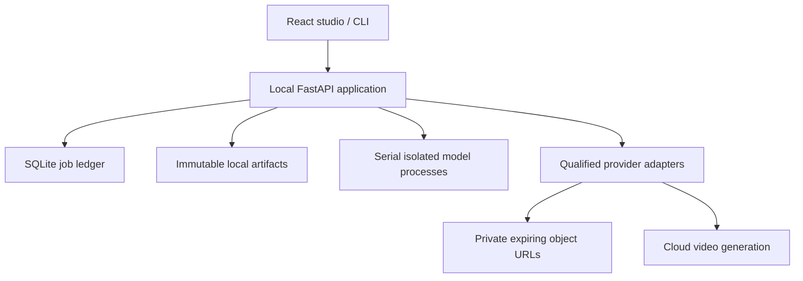

# System design

## Interfaces

Recipe revisions specify source interval, preparation mode, subjects, references, audio, prompt, and model profiles. Artifacts record hash, producer, timing, dimensions, and revision. Attempts record submission intent, provider/account identity, reservation, remote IDs, expiry, results, and settled cost. Approvals bind to preparation fingerprint or an immutable attempt.

SQLite transactions protect budget reservations and duplicate operations. Workers alone own GPU work; the API owns ledger transitions. Cache keys include upstream hashes, stage parameters, and implementation/model versions. Masks change downstream compositing, not unrelated vocals or depth.

## States

Jobs: imported → queued → preparing → review → approved → generating → preview → exporting → complete. Failures retain artifacts. Cancellation stops future scheduling and local subprocesses. Existing paid requests remain polled for reconciliation.

Attempts: submitting → pending → succeeded / failed; ambiguous submission → unknown_submission. Unknown submission retains its reservation and blocks another paid request. Restart changes interrupted local tasks to queued; in-progress remote attempts resume polling. Native finalization uses the original draft ID/account and never uploads a downloaded draft as a substitute.

## Data and privacy

Runtime data defaults to ~/.local/share/openjutsu on Linux. The Windows source is copied on import. Models are separate downloads. Public routes resolve artifact IDs rather than arbitrary filesystem paths. The API binds localhost and checks browser origins on mutations. Credentials are stored in a permission-restricted runtime file, omitted from responses and job bundles. Only explicitly reviewed conditioning media and identity references are uploaded through private S3-compatible storage.

## Acceptance

Review frame alignment, timing, masks, body replacement, original audio, and native/upscaled provenance. Qualification requires a successful pilot, reviewed media policy, actual settled billing, and human scores ≥4/5 for identity, motion, and temporal stability. No subject swaps or visible synchronization errors are accepted. Hardware and provider qualifications are reported separately from implemented interfaces.
